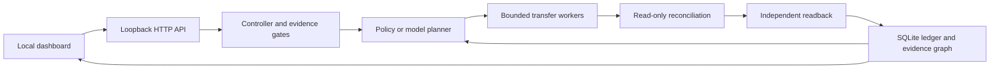

# Mailbridge

**A local Cafe24 migration workspace built on Madan's Gmail migration tools.**

A planner chooses the next permitted operation. Bounded workers carry it out. An investigator reconciles uncertain writes and a verifier independently reads destination evidence. Every decision and source-row outcome persists in a dashboard-backed SQLite ledger.

This extends the real public [gmail-migration-tools](https://github.com/MadanChaollaPark/gmail-migration-tools) repository at `cee4dac053a3ad1389a457b57a40f2e90af210b8`. The original Gmail engine and its 50-test suite remain unchanged. See the preserved [engine README](ENGINE_README.md), [ITCCK engineering case study](CASE_STUDY.md) and [Gmail usage guide](USAGE.md). This checkout is local work on `codex/agentic-migration`, not a published release.

## Start locally

Python 3.11+ on macOS/Linux. The dashboard, local rehearsal, POP3 capture and model transport use the standard library.

```sh
python3 -m mailbridge serve
# http://127.0.0.1:8790
```

Or double-click `start-mailbridge.command`, which uses `.venv` when present. State is retained under the ignored owner-only `runtime/mailbridge/` directory. Stop with Control-C and resume paused work after restarting.

**Run recovery demo** creates 14 fictional EML files with two exact exported copies. A successful copy deliberately loses its response. The investigator finds the matching destination evidence without another write. Fixtures, provider and faults are synthetic; files, hashes, copies, persisted state and verification are real.

**New migration** also offers a clean demo, a rejection/review demo, a real EML-folder rehearsal, and an existing Gmail profile.

## Architecture



| File | Responsibility |
| --- | --- |
| `mailbridge/engine.py` | Planner/tool loop, workers, investigation, verification, Gmail adapter |
| `mailbridge/store.py` | Task/message ledger and parent-linked goal/decision/job/fact graph |
| `mailbridge/planner.py` | Offline policy and optional Responses API model planner |
| `mailbridge/skills/cafe24-migration/SKILL.md` | Actual playbook supplied to the model |
| `mailbridge/pop3_source.py` | Read-only, resumable POP3-to-EML capture |
| `mailbridge/server.py` | Local API, request controls and single-server runtime lock |
| `mailbridge/web/` | Dashboard, inventory search, review and report exports |
| `gmail_eml_migration_v2.py` | Your original Gmail engine, unchanged |

The mailbox map is derived from configuration and inventoried folders. The exploration graph persists decisions, jobs, receipts, observations and reviews with parent IDs. No separate graph database or MCP server is needed for this version.

## Capture POP3 mail

Use the customer's exact host, port and TLS configuration. Capture requires TLS or STARTTLS, verifies certificates, saves UIDL-based checkpoints and never issues `DELE`. It does not guess hosts or fall back to plaintext. Use EML exports if the exact service lacks usable secure POP3.

```sh
read -s MAILBRIDGE_POP_PASSWORD
export MAILBRIDGE_POP_PASSWORD
python3 -m mailbridge capture-pop3 \
  --host YOUR_POP_HOST --username person@example.org \
  --security tls --port 995 --output /absolute/private/cafe24-export
unset MAILBRIDGE_POP_PASSWORD
```

For supported STARTTLS, use `--security starttls --port 110`. `--limit 5` bounds a first capture. State binds the directory to its account; resume verifies saved hashes and retrieves unseen UIDLs. No mailbox password is persisted.

POP3 captures only exposed mail, not all Sent/webmail folders or computer-only archives. Cafe24 webmail has [per-folder EML export](https://help.cafe24.com/faq/business-tools/webmail/backup-restore/webmail_backup_how_to_backup_received_emails/); [free hosting POP3 is a separate service](https://help.cafe24.com/faq/web-hosting/introduce/setup-management/free_pop3_mail_service_usage/). PST/MBOX parsing is not implemented; export those archives to EML separately.

## Connect Google Workspace / Gmail

Use the original [profile format](../examples/profile.example.json) and [phase-based instructions](USAGE.md). Configure a private export, OAuth Desktop client, state directory and token storage. Google dependencies are needed only for actual Gmail operations:

```sh
uv venv .venv
uv pip install --python .venv/bin/python -r requirements.txt
.venv/bin/python gmail_eml_migration_v2.py authorize \
  --profile /absolute/private/profile.json
```

Choose **New migration → Gmail profile** and enter the profile path. **Inventory source** creates or validates the original frozen manifest without Gmail writes. Review it, then **Confirm Gmail import** using the exact destination and frozen count.

The adapter invokes your original engine as a subprocess, serially within a mailbox. It retains OAuth account binding, source checks, MIME repair rules, exact-copy handling, checkpoint locks, uncertainty reconciliation and final Gmail readback. The controller prevents overlapping active tasks for one destination. Do not run a separate external importer against the same mailbox.

Gmail exceptions use the original CLI `review` workflow. The dashboard does not invent repairs, launch OAuth consent, automatically accept rejections or retry uncertain writes. Its pause button is disabled during a Gmail mailbox operation; other mailbox tasks can run independently.

## Enable actual model planning

The default **offline policy** is deterministic and clearly labeled. It is not an LLM run.

```sh
# Supply MAILBRIDGE_LLM_KEY through your shell or secret manager.
export MAILBRIDGE_LLM_MODEL=YOUR_MODEL_ID
# Optional MAILBRIDGE_LLM_ENDPOINT; defaults to https://api.openai.com/v1/responses
.venv/bin/python -m mailbridge serve --planner llm
```

The endpoint must implement Responses API function calling. The adapter follows the [official schema](https://developers.openai.com/api/docs/guides/function-calling). It requests one strict `choose_next_action` call from the currently permitted operations. Each round gets fresh persisted evidence. Requests have `store:false`; model input excludes message bodies, subjects, filenames, paths, addresses and credentials. API keys come only from `MAILBRIDGE_LLM_KEY`, not other apps' stores.

The controller independently validates actions and evidence citations. Failed or invalid responses stop for review, with no hidden fallback. Each start has a 100-round budget. The model transport is covered by offline tests; a live model call has not been exercised for this prototype.

## Checks and boundaries

```sh
.venv/bin/python -m unittest discover -s tests -v
node --check mailbridge/web/app.js
```

Tests use fictional messages and mocked POP3, Google and model services. New checks cover lost-response reconciliation, restart recovery, concurrent claims, source drift, destination corruption, exact-copy folder mapping, local-only accounting, Gmail confirmation, model validation, TLS-before-credentials and cross-origin request rejection.

Local verification compares exact EML bytes and folder mappings. Gmail retains the original engine's narrower scope: IDs, selected headers, dates and labels. Upload receipts and local-only retention do not establish complete Gmail coverage.

This is a local prototype. Microsoft 365, PST parsing, mailbox provisioning, contacts/calendars, DNS cutover and automatic source deletion are not implemented. No customer mail, POP3 credentials, Google grants or paid model credentials were used for verification. Keep the original service until a real migration and routing cutover are independently checked.
